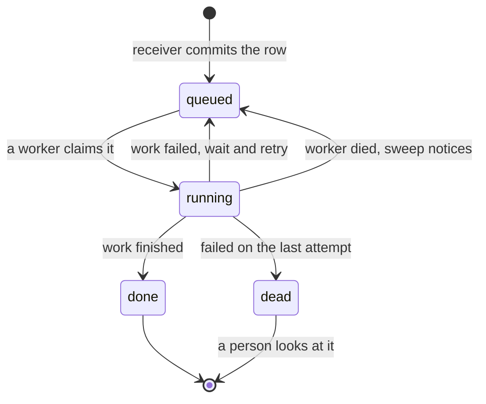

# Queue broker POC · Celery, Redis and Postgres

A small, self-contained proof of one question: **how do we queue background work so that nothing accepted is ever lost?**

The answer it tests: **Postgres holds the record of every job, and Redis only carries row ids.** Celery on Redis does the dispatching. If Redis loses a message or a worker dies, the row is still in Postgres and a sweep puts it back on the queue.

**Status: POC. Six failure cases run against real Postgres, Redis and Celery, all passing on a laptop. Not yet run on Linux.**

## System design


1. **A job is accepted when its row is committed in Postgres.** Publishing to Redis comes second and is allowed to fail.
2. **Redis carries only the row id.** If Redis loses a message, the row is still there.
3. **A worker claims the row before working**, so a second delivery of the same id is skipped.
4. **A sweep runs every few seconds** and publishes again any row that is unfinished: never published, lost by Redis, or held by a worker that died.
5. **Timed work is a row with a due time.** Nothing waits inside Redis.

The life of one job:



## Results

Latest run: **6 of 6 passed**. Full write-up with a timeline per case: [`results/RESULTS.md`](results/RESULTS.md). The same results as a page with hover details: open `results/report.html` in a browser.

| # | What was broken on purpose | What happened |
| --- | --- | --- |
| 1 | A worker was killed (`SIGKILL`) mid-job | The job ran again on another worker and finished once |
| 2 | Redis was wiped with five jobs queued | All five still finished; the sweep published them again from Postgres |
| 3 | A reminder came due, and was fired twice | It was sent once; a second row with the same key was refused |
| 4 | A slow queue had a backlog | Four mail jobs finished in under half a second while extraction was still waiting |
| 5 | One job was delivered four times | One delivery ran it; three were skipped |
| 6 | A job failed every time | Retried with a growing wait, then set aside with its error kept |

Case 1, as the report draws it. Blue is running, the dashed line is the kill, and the second blue bar is the retry:


Case 4, where the mail jobs (bottom four rows) are done almost at once while the extraction jobs wait their turn:


One finding worth knowing before choosing timeouts: with Redis as the broker, a job held by a killed worker is not handed back until the broker's visibility timeout passes (one hour as configured here). In case 1 it was the Postgres sweep that recovered the job, in about ten seconds. Recovery time is a setting we own, not a broker default.

## Run it

Needs Docker and [uv](https://docs.astral.sh/uv/).

```bash
docker compose up -d --wait          # Postgres on 55432, Redis on 56379, both in memory
uv run python -m queue_poc.prove     # about 90 seconds; prints PASS or FAIL and rewrites results/
open results/report.html
uv run pytest                        # 12 tests; the database ones skip if Postgres is down
docker compose down
```

`prove.py` starts and stops its own Celery workers and beat. To rebuild the report from the last run without any services: `uv run python -m queue_poc.report`.

To drive it by hand:

```bash
uv run celery -A queue_poc.tasks worker -Q mail,extract,browser,outbox,default -c 4 -P threads
uv run celery -A queue_poc.tasks beat
uv run uvicorn queue_poc.receiver:create_app --factory --port 8030
curl -X POST localhost:8030/jobs -H 'content-type: application/json' -d '{"kind":"mail","value":"sleep=1"}'
```

## Worker rules

These are what make the results above hold. The real workers should keep them.

| Rule | Where |
| --- | --- |
| Acknowledge after the work, never before | `task_acks_late`, `task_reject_on_worker_lost` in `tasks.py` |
| Take one job at a time | `worker_prefetch_multiplier = 1` |
| Claim the row before working; skip if it cannot be claimed | `db.claim` |
| Finish and fail only your own attempt | `db.finish` and `db.fail` match on the attempt number |
| One queue per kind of work | `QUEUE_FOR_KIND` in `config.py` |
| A running row older than the limit is abandoned and queued again | `db.reset_stale`, `QUEUE_POC_STALE_SECONDS` |
| The limit is longer than the longest job | Set per deployment; also the job's hard time limit |
| Timed work is a due time in Postgres, read by beat | `reminders` table, `db.fire_due_reminders` |
| A send is a row with a unique key, written with its cause | `outbox` table |
| Exactly one beat process | Deployment |

## What this does not show

- Workers do placeholder work (`sleep` or `fail`). "Finished once" is proven for the database row. A real call to another system between claim and finish still needs its own idempotency key.
- It ran with Celery's thread pool, because the default prefork pool fails on macOS with Python 3.13. Linux containers use prefork; rerun `prove.py` there before relying on the results. The thread pool does not enforce the hard time limit.
- One Redis, no persistence, no failover. Two beat processes at once was not tested.
- No dashboard for jobs that were set aside, and no way to re-run one except by editing the row.
- Timings in `prove.py` are shortened to seconds. Production values (see `config.py`) are minutes.

## Layout

```
src/queue_poc/
  config.py     connection strings, limits, queue names
  db.py         Postgres: inbox, outbox, reminders, and the event log the report reads
  tasks.py      Celery app and settings, the job task, sweep, reminders, outbox send
  receiver.py   accept-then-publish HTTP endpoint
  prove.py      the six failure cases, run for real
  report.py     results.json to report.html, RESULTS.md and the SVG timelines
tests/          database rules and report building
results/        output of the latest run (committed so it can be read without running anything)
```
