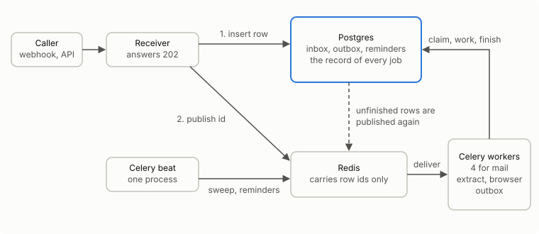
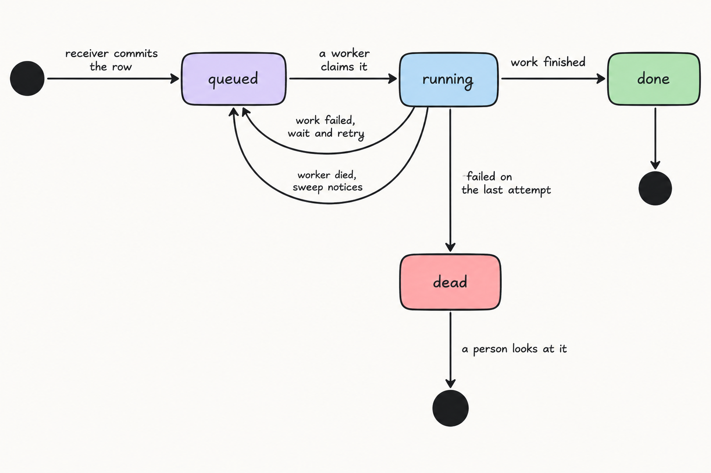
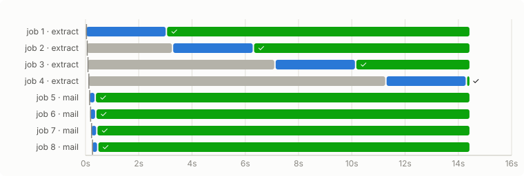

# Queue POC: does anything get lost?

A job queue on Celery and Redis, with Postgres as the record. Each case below breaks something on purpose and shows what happened to the jobs.

# 6 of 6

**failure cases behaved as designed**

<sub>Run 2026-10-12T20:29:33+00:00, Darwin arm64, Python 3.13.15, Celery 5.6.3 (threads pool), Redis 7.4.10, Postgres 16.15</sub>

## System design



1. **A job is accepted when its row is committed in Postgres.** Publishing to Redis comes second and is allowed to fail.
2. **Redis carries only the row id.** If Redis loses a message, the row is still there.
3. **A worker claims the row before working**, so a second delivery of the same id is skipped.
4. **A sweep runs every few seconds** and publishes again any row that is unfinished: never published, lost by Redis, or held by a worker that died.
5. **Timed work is a row with a due time.** Nothing waits inside Redis.

## The life of one job



## What happened in each case

One row per job. Time runs left to right from the start of the case. Timings for this run were shortened: a running job counts as abandoned after 6s, a queued row is published again after 4s, and the sweep runs every 2s.


### 1. A worker is killed mid-job: passed

| | |
| --- | --- |
| **What we did** | Started a 3-second job, then sent SIGKILL to the worker while it was running. |
| **Expected** | The job runs again on another worker and finishes exactly once. |
| **Observed** | Row stayed &#x27;running&#x27; after the kill. The sweep queued it again and a second worker finished it 10s later. attempts=2, finished=1. |


<details><summary>All 8 events as a table</summary>

| Time | Subject | Event | Detail |
| --- | --- | --- | --- |
| 0.01s | job:1 | accepted | mail sleep=3 |
| 0.04s | job:1 | published |  |
| 0.04s | job:1 | claimed | attempt 1 |
| 1.07s | chaos | chaos | worker killed |
| 7.89s | job:1 | stale | worker stopped mid-job |
| 7.90s | job:1 | published | by the sweep |
| 7.92s | job:1 | claimed | attempt 2 |
| 10.93s | job:1 | finished |  |

</details>

### 2. Redis is wiped with jobs queued: passed

| | |
| --- | --- |
| **What we did** | Queued five jobs with no worker running, then deleted everything in Redis. |
| **Expected** | All five jobs still finish, because their rows are in Postgres. |
| **Observed** | Redis held 5 messages, then 0 after the wipe. The sweep published all 5 again from Postgres; each finished once (5 finishes). |


<details><summary>All 26 events as a table</summary>

| Time | Subject | Event | Detail |
| --- | --- | --- | --- |
| 0.03s | job:1 | accepted | mail sleep=0.1 |
| 0.08s | job:1 | published |  |
| 0.11s | job:2 | accepted | mail sleep=0.1 |
| 0.14s | job:2 | published |  |
| 0.18s | job:3 | accepted | mail sleep=0.1 |
| 0.21s | job:3 | published |  |
| 0.25s | job:4 | accepted | mail sleep=0.1 |
| 0.28s | job:4 | published |  |
| 0.31s | job:5 | accepted | mail sleep=0.1 |
| 0.34s | job:5 | published |  |
| 1.38s | chaos | chaos | Redis wiped |
| 4.56s | job:1 | published | by the sweep |
| 4.56s | job:3 | published | by the sweep |
| 4.56s | job:5 | published | by the sweep |
| 4.56s | job:4 | published | by the sweep |
| 4.56s | job:2 | published | by the sweep |
| 4.65s | job:2 | claimed | attempt 1 |
| 4.65s | job:1 | claimed | attempt 1 |
| 4.65s | job:3 | claimed | attempt 1 |
| 4.66s | job:4 | claimed | attempt 1 |
| 4.77s | job:2 | finished |  |
| 4.77s | job:3 | finished |  |
| 4.77s | job:1 | finished |  |
| 4.78s | job:4 | finished |  |
| 6.80s | job:5 | claimed | attempt 1 |
| 6.98s | job:5 | finished |  |

</details>

### 3. A timed reminder comes due: passed

| | |
| --- | --- |
| **What we did** | Stored a reminder due in 3 seconds, then tried to fire it twice and to add its send twice. |
| **Expected** | It fires after the due time, from Postgres, and is sent once. |
| **Observed** | Beat fired the reminder after its due time and wrote 1 outbox row, sent 1 time. A second insert with the same key was refused. |


<details><summary>All 4 events as a table</summary>

| Time | Subject | Event | Detail |
| --- | --- | --- | --- |
| 0.01s | reminder:1 | reminder_set | due in 3s |
| 4.26s | outbox:1 | outbox_added | reminder:1 |
| 4.26s | reminder:1 | fired |  |
| 6.26s | outbox:1 | sent |  |

</details>

### 4. A slow queue has a backlog: passed

| | |
| --- | --- |
| **What we did** | Queued four 3-second extraction jobs on a one-worker queue, then four short mail jobs. |
| **Expected** | Mail finishes straight away while extraction is still working through its backlog. |
| **Observed** | 4 mail jobs finished in 0.5s. At that moment the extract queue had 1 running and 3 waiting. |



<details><summary>All 32 events as a table</summary>

| Time | Subject | Event | Detail |
| --- | --- | --- | --- |
| 0.02s | job:1 | accepted | extract sleep=3 |
| 0.06s | job:1 | published |  |
| 0.08s | job:1 | claimed | attempt 1 |
| 0.12s | job:2 | accepted | extract sleep=3 |
| 0.16s | job:2 | published |  |
| 0.18s | job:3 | accepted | extract sleep=3 |
| 0.21s | job:3 | published |  |
| 0.24s | job:4 | accepted | extract sleep=3 |
| 0.28s | job:4 | published |  |
| 0.31s | job:5 | accepted | mail sleep=0.2 |
| 0.34s | job:5 | published |  |
| 0.35s | job:5 | claimed | attempt 1 |
| 0.36s | job:6 | accepted | mail sleep=0.2 |
| 0.39s | job:6 | published |  |
| 0.39s | job:6 | claimed | attempt 1 |
| 0.41s | job:7 | accepted | mail sleep=0.2 |
| 0.44s | job:7 | published |  |
| 0.44s | job:7 | claimed | attempt 1 |
| 0.47s | job:8 | accepted | mail sleep=0.2 |
| 0.50s | job:8 | published |  |
| 0.51s | job:8 | claimed | attempt 1 |
| 0.58s | job:5 | finished |  |
| 0.62s | job:6 | finished |  |
| 0.67s | job:7 | finished |  |
| 0.74s | job:8 | finished |  |
| 3.11s | job:1 | finished |  |
| 3.48s | job:2 | claimed | attempt 1 |
| 6.51s | job:2 | finished |  |
| 7.32s | job:3 | claimed | attempt 1 |
| 10.34s | job:3 | finished |  |
| 11.49s | job:4 | claimed | attempt 1 |
| 14.52s | job:4 | finished |  |

</details>

### 5. The same job is delivered four times: passed

| | |
| --- | --- |
| **What we did** | Published one row id to the broker four times. |
| **Expected** | One delivery claims the row; the other three are skipped. |
| **Observed** | 4 deliveries of the same row id: 1 claimed it, 3 were skipped. attempts=1, finished=1. |


<details><summary>All 7 events as a table</summary>

| Time | Subject | Event | Detail |
| --- | --- | --- | --- |
| 0.01s | job:1 | accepted | mail sleep=1 |
| 0.03s | job:1 | published |  |
| 0.03s | job:1 | claimed | attempt 1 |
| 0.05s | job:1 | duplicate | delivery skipped: the row was not claimable |
| 0.05s | job:1 | duplicate | delivery skipped: the row was not claimable |
| 0.05s | job:1 | duplicate | delivery skipped: the row was not claimable |
| 1.05s | job:1 | finished |  |

</details>

### 6. A job keeps failing: passed

| | |
| --- | --- |
| **What we did** | Queued a job that always raises, with the attempt limit set to 3. |
| **Expected** | It is retried with a growing wait, then set aside for a person to look at. |
| **Observed** | Failed 3 times with a longer wait before each retry, then marked &#x27;dead&#x27; with the error kept: RuntimeError: simulated failure. |


<details><summary>All 10 events as a table</summary>

| Time | Subject | Event | Detail |
| --- | --- | --- | --- |
| 0.02s | job:1 | accepted | mail fail |
| 0.04s | job:1 | published |  |
| 0.05s | job:1 | claimed | attempt 1 |
| 0.07s | job:1 | retry | RuntimeError: simulated failure |
| 3.07s | job:1 | published | by the sweep |
| 3.10s | job:1 | claimed | attempt 2 |
| 3.11s | job:1 | retry | RuntimeError: simulated failure |
| 11.08s | job:1 | published | by the sweep |
| 11.09s | job:1 | claimed | attempt 3 |
| 11.10s | job:1 | dead | RuntimeError: simulated failure |

</details>

## What this run does not show

1. Workers did placeholder work (a sleep, or a raised error). "Finished once" is proven for the database row; a real call to another system still needs its own idempotency key.
2. This run used Celery's **threads** pool on Darwin arm64. Linux containers use the prefork pool; rerun there before relying on these results.
3. One Redis with no persistence and no failover. Two beat processes running at once was not tested.

## Run it

Needs Docker and [uv](https://docs.astral.sh/uv/).

```bash
docker compose up -d --wait          # Postgres on 55432, Redis on 56379, both in memory
uv run python -m queue_poc.prove     # about 90 seconds; rewrites this README and results/
uv run pytest
docker compose down
```

To rebuild this page from the last run without any services: `uv run python -m queue_poc.report`.

## Worker rules

| Rule | Where |
| --- | --- |
| Acknowledge after the work, never before | `task_acks_late`, `task_reject_on_worker_lost` in `tasks.py` |
| Take one job at a time | `worker_prefetch_multiplier = 1` |
| Claim the row before working; skip if it cannot be claimed | `db.claim` |
| Finish and fail only your own attempt | `db.finish` and `db.fail` match on the attempt number |
| One queue per kind of work | `QUEUE_FOR_KIND` in `config.py` |
| A running row older than the limit is abandoned and queued again | `db.reset_stale`, `QUEUE_POC_STALE_SECONDS` |
| The limit is longer than the longest job | Set per deployment; also the job's hard time limit |
| Timed work is a due time in Postgres, read by beat | `reminders` table, `db.fire_due_reminders` |
| A send is a row with a unique key, written with its cause | `outbox` table |
| Exactly one beat process | Deployment |

## Layout

```
src/queue_poc/
  config.py     connection strings, limits, queue names
  db.py         Postgres: inbox, outbox, reminders, and the event log this page is drawn from
  tasks.py      Celery app and settings, the job task, sweep, reminders, outbox send
  receiver.py   accept-then-publish HTTP endpoint
  prove.py      the six failure cases, run for real
  report.py     results.json to this README and the SVG images
tests/          database rules and report building
results/        raw data and images from the latest run
docs/           the job life-cycle picture
```
